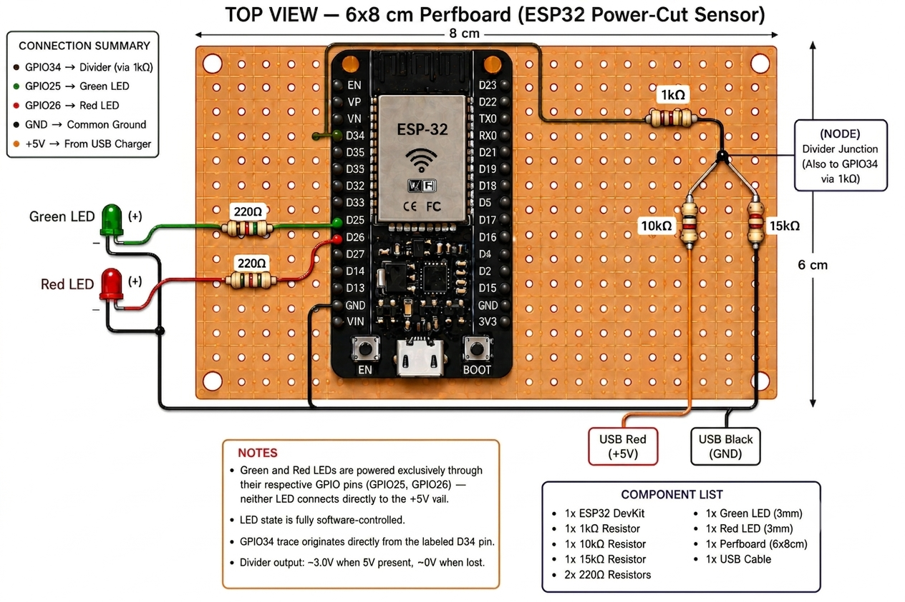

# UPS Controller ESP32

ESP32-based power-loss controller for a homelab/server host.

When AC power disappears, the controller starts a shutdown countdown. If the outage lasts long enough, it calls a host shutdown API, waits until the host is actually offline, and then stays quiet until power returns. When mains power comes back, it sends a Wake-on-LAN packet and waits for the host health check to recover. All state transitions are published to an MQTT broker for Home Assistant integration.

## Features

- Detects external power presence with a dedicated GPIO input
- Shows power state on red/green status LEDs
- Connects to Wi-Fi in STA mode and auto-retries on disconnect
- Delays shutdown to avoid reacting to short outages
- Calls an authenticated HTTP shutdown endpoint
- Confirms the host is really down before considering shutdown complete
- Sends Wake-on-LAN only after shutdown is confirmed, with up to 20 automatic retries
- Polls a host health endpoint after wake until the server is back online
- Suppresses repeated noisy logs once shutdown has already been confirmed
- Maintains a persistent 30-event ring buffer in NVS flash to survive sudden outages
- Reports state to Home Assistant via MQTT with auto-discovery
- Accepts remote commands (cancel shutdown, force WOL, force shutdown, clear log) over MQTT
- Publishes live shutdown countdown over MQTT
- Dumps full event log timeline to Home Assistant automatically on reconnect
- Uses MQTT Last Will and Testament for ESP32 availability tracking
- Accepts firmware updates pushed over the LAN, using a two-slot OTA layout with automatic rollback

## Current Host Flow

This project is currently configured for a host on `192.168.0.89`:

- Shutdown API: `POST http://192.168.0.89:8787/api/v1/host/poweroff`
- Health check: `GET http://192.168.0.89:8787/health`
- Wake target MAC: `AA:BB:CC:DD:EE:FF`

Expected shutdown API behavior:

- Requires `Authorization: Bearer <token>`
- Returns `202 Accepted` when shutdown has been accepted

Expected host-side shutdown action:

```sh
docker stop $(docker ps -q) && sudo shutdown -h
```

## How It Works

Normal sequence:

1. ESP32 boots and connects to Wi-Fi.
2. GPIO power input is read periodically.
3. If power is lost, a shutdown countdown starts.
4. If power comes back before the countdown expires, shutdown is canceled.
5. If the countdown expires, the controller calls the shutdown API.
6. The controller polls the health endpoint until the host stops responding.
7. Once the host is confirmed down, polling stops while power is still out.
8. When power returns, the controller sends a Wake-on-LAN packet.
9. The controller polls the health endpoint until the host is reachable again.
10. The controller returns to idle.

Important behavior detail:

- If power returns while the host is still shutting down, the ESP32 **keeps watching** instead of ending the episode. A host stopping many services keeps answering its health endpoint for tens of seconds, so "power is back and the host still answers" does not mean the shutdown did not happen. The controller waits up to `SHUTDOWN_CONFIRM_TIMEOUT_MS` (5 minutes) for the host to go down; when it does, Wake-on-LAN is sent immediately because mains is already back.
- If the host never goes down inside that window, the request genuinely had no effect: the controller returns to idle and records `SHUTDOWN_FAILED` with `extra=3`.
- A health check only counts as "host is up" when it returns HTTP `2xx`. A `4xx`/`5xx` response is treated as the host not being healthy, so a broken health endpoint cannot keep the controller waiting indefinitely.
- Shutdown requests are retried every `15 s` for up to 20 attempts. After that the controller backs off to one attempt every 5 minutes and records a `SHUTDOWN_FAILED` event, because the host is still running with power out and continuing to try matters more than giving up.
- A shutdown request that is **sent but never answered** is not a failure. A host that stops services before replying looks exactly like a timeout, so that case is logged as `Shutdown request sent, no response yet` and the host state decides the outcome. Only a request that could not be delivered, or that was explicitly rejected, records `SHUTDOWN_FAILED` with `extra=0`.

### Timing characteristics

Power state is sampled every `power_poll_interval_ms` (100 ms), but **not while a host HTTP check is in flight**. The controller's HTTP calls are synchronous, so in the `WAITING_FOR_HOST_DOWN`, `WAITING_FOR_HOST_UP` and startup-recovery states the main loop can block for up to `health_check_timeout_ms` (10 s) per attempt. Because host checks are also rate-limited to one every 3 s, the effective sampling cadence in those states is roughly 13 s rather than 100 ms, so a mains transition during that window is noticed late by up to about 10 s.

The impact is bounded rather than dangerous, and two things it does *not* do are worth stating because they are easy to assume:

- It does not starve the idle task. The block is a socket wait, so the CPU is yielded and the task watchdog is satisfied.
- It does not risk a stack overflow. Measured on hardware, the whole `esp_http_client_perform` path peaks at roughly 1.1 KB of stack, which fits both the 3.5 KB main task and the 2 KB FreeRTOS timer task.

**Do not shorten `health_check_timeout_ms` to reduce this window.** A timeout that is too short makes a slow-but-healthy host look unreachable, and the controller treats unreachable as *shutdown confirmed*, which can produce a spurious Wake-on-LAN while the host is still running. The generous timeout exists to avoid that false negative — removing the blind window properly would mean moving the HTTP calls to a dedicated task.

One related characteristic: the shutdown POST is issued from the FreeRTOS timer callback, so it briefly occupies the timer service task for up to its 5 s timeout. Only one software timer is used in this project, so the practical effect is small.

The countdown is published only when the remaining second changes, so the 100 ms poll loop does not generate 10 messages per second of MQTT traffic.

## MQTT / Home Assistant

The controller connects to an MQTT broker and publishes state on every transition. Home Assistant auto-discovery payloads are sent on each MQTT connect, creating entities automatically.

### Published Topics

| Topic | Payload | Notes |
|---|---|---|
| `powerguard/power_state` | `"online"` / `"lost"` | Retained |
| `powerguard/host_state` | `"up"` / `"down"` | Retained |
| `powerguard/countdown` | Seconds remaining or `"idle"` | Updated every poll cycle during countdown |
| `powerguard/last_event` | Free text, e.g. `"shutdown cancelled"` | Retained |
| `powerguard/event_log` | JSON array of last 30 events | Retained, automatically published on reconnect |
| `powerguard/availability` | `"online"` / `"offline"` | LWT topic, retained. `"offline"` set by broker if ESP32 disconnects |
| `powerguard/ota_status` | `"starting"`, `"updating 40%"`, `"complete, rebooting"`, `"failed: ..."` | Retained, published while a firmware update runs |

The `availability` topic is the MQTT Last Will and Testament. Home Assistant uses it to distinguish "ESP32 itself is offline" from "mains power is lost" — these are different failure states.

### Subscribed Topics (Commands)

| Topic | Effect |
|---|---|
| `powerguard/command/cancel_shutdown` | Cancels an in-progress shutdown countdown (same as power restoration) |
| `powerguard/command/force_wol` | Sends an immediate Wake-on-LAN packet regardless of controller state |
| `powerguard/command/force_shutdown`| Instantly aborts countdown and sends shutdown API request |
| `powerguard/command/clear_log` | Erases the NVS flash event ring buffer and clears dashboard table |

### Home Assistant Discovery

On connect, retained discovery config payloads are published for these entities:

| Entity | HA Component | Device Class / Icon |
|---|---|---|
| Mains Power | `binary_sensor` | `power` |
| Host Online | `binary_sensor` | `connectivity` |
| Shutdown Countdown | `sensor` | `mdi:timer-alert-outline` |
| Last Event | `sensor` | `mdi:message-text-clock-outline` |
| Event Log | `sensor` | `mdi:format-list-bulleted-type` |
| Cancel Shutdown | `button` | `mdi:cancel` |
| Force Wake-on-LAN | `button` | `mdi:power` |
| Force Shutdown | `button` | `mdi:power-plug-off` |
| Clear Event Log | `button` | `mdi:delete-sweep` |
| OTA Status | `sensor` | `mdi:cloud-download-outline` |

All entities are grouped under a single "PowerGuard" device in the HA UI, identified by the ESP32's MAC address.

### Event Log Dashboard Card

To visualize the persistent event log beautifully in Home Assistant, create a Markdown Card in your Lovelace dashboard and use the following Jinja template. It will automatically parse the `event_log` JSON, map events to nice emojis, and instantly auto-refresh whenever a new event occurs:

```markdown
<details open>
<summary><b>Latest 30 Events (Click to collapse/expand)</b></summary>

| ⏱️ Uptime | 📜 Event | ℹ️ Details |
| :--- | :--- | :--- |



  
  
  
  {%- set m = ((evt.t % 3600) / 60) | int %}
  {%- set s = evt.t % 60 %}
  {%- set t_str = "%02d:%02d:%02d" | format(h, m, s) %}
| `{{ t_str }}` | **{{ evt_name }}** | {{ evt.x | default('-') }} |


| - | No events recorded | - |


</details>
<span style="display:none">{{ states('sensor.powerguard_last_event') }}</span>
```

## Hardware

Current GPIO usage:

- `GPIO34`: power sense input
- `GPIO25`: green LED, power present
- `GPIO26`: red LED, power lost
- `GPIO2`: onboard Wi-Fi status LED

Power sensing logic:

- HIGH on `GPIO34` means power present
- LOW on `GPIO34` means power lost

## Board Wiring

Actual perfboard wiring reference:



This board is a compact ESP32 power-cut sensor built on a `6 cm x 8 cm` perfboard. The ESP32 reads a divided version of the USB `+5V` rail on `GPIO34` to decide whether mains-backed power is present, and it drives two status LEDs directly from GPIO pins.

Connection summary:

- `GPIO34`: divider sense input from the USB `+5V` line
- `GPIO25`: green LED output
- `GPIO26`: red LED output
- `GND`: shared/common ground
- `USB +5V`: source used for the divider input

Divider network shown in the board image:

- `1k` from ESP32-side sense trace into the divider node
- `10k` from divider node to USB `+5V`
- `15k` from divider node to `GND`

LED wiring shown in the board image:

- Green LED anode is driven from `GPIO25` through `220 ohm`
- Red LED anode is driven from `GPIO26` through `220 ohm`
- Both LED cathodes return to common ground

Important notes for this build:

- The LEDs are software-controlled and are not tied directly to the `+5V` rail
- The `GPIO34` trace comes from the divider output, not directly from `+5V`
- The divider output is approximately `3.0V` when USB `+5V` is present
- `GPIO34` is input-only on ESP32, which makes it suitable for power sensing

## Project Layout

```text
main/
  app/
    main.c
    ups.c
    ups.h
  config/
    config.h
    config.c        # local, ignored by git
  drivers/
    leds.c
    leds.h
    power_sensor.c
    power_sensor.h
  network/
    mqtt_manager.c
    mqtt_manager.h
    ota_manager.c
    ota_manager.h
    shutdown_client.c
    shutdown_client.h
    time_sync.c
    time_sync.h
    wake_on_lan.c
    wake_on_lan.h
    wifi_manager.c
    wifi_manager.h
  idf_component.yml  # managed component dependency (espressif/mqtt)
partitions.csv       # OTA partition layout
sdkconfig.defaults   # partition table and rollback defaults
```

## Configuration

Configuration lives in:

- `main/config/config.h`
- `main/config/config.c`

`main/config/config.c` is intentionally ignored by git so Wi-Fi credentials and bearer tokens stay local.

Example configuration:

```c
#include "config.h"

const ups_config_t g_ups_config = {
    .power_poll_interval_ms = 5000,
    .shutdown_delay_seconds = 30,
    .health_check_timeout_ms = 20000,
    .wifi_ssid = "YOUR_WIFI_SSID",
    .wifi_password = "YOUR_WIFI_PASSWORD",
    .wake_mac = "AA:BB:CC:DD:EE:FF",
    .shutdown_url = "http://192.168.0.89:8787/api/v1/host/poweroff",
    .shutdown_bearer_token = "YOUR_TOKEN",
    .healthcheck_url = "http://192.168.0.89:8787/health",
    .mqtt_broker_url = "mqtt://192.168.0.89",
    .mqtt_port = 1883,
    .mqtt_username = "esp32",
    .mqtt_password = "YOUR_MQTT_PASSWORD",
    .ota_port = 3232,
    .ota_bearer_token = "YOUR_OTA_TOKEN",
    .ntp_server = "pool.ntp.org",
    .device_hostname = "powerguard",
};
```

Configuration fields:

- `power_poll_interval_ms`: interval between power-state checks
- `shutdown_delay_seconds`: how long power must stay out before shutdown is triggered
- `health_check_timeout_ms`: timeout used for health-check HTTP requests
- `wifi_ssid`: Wi-Fi network name
- `wifi_password`: Wi-Fi password
- `wake_mac`: MAC address of the host to wake
- `shutdown_url`: host shutdown endpoint
- `shutdown_bearer_token`: bearer token for shutdown authentication
- `healthcheck_url`: host endpoint used to confirm down/up status
- `mqtt_broker_url`: MQTT broker URI, e.g. `mqtt://192.168.0.89`
- `mqtt_port`: MQTT broker port, typically `1883`
- `mqtt_username`: MQTT username
- `mqtt_password`: MQTT password (keep in gitignored `config.c`)
- `ota_port`: LAN OTA HTTP server port, `0` uses the default `3232`
- `ota_bearer_token`: token required on OTA requests, leave `NULL` only on a trusted network
- `ntp_server`: NTP host used for the wall clock, `NULL` uses `pool.ntp.org`. Set this if the LAN has no internet or runs its own NTP server
- `device_hostname`: DHCP hostname, `NULL` uses `powerguard`. Every ESP32 otherwise presents the ESP-IDF default `espressif`, which a second board would silently take over. Note that a **static DHCP reservation on the router takes precedence** over this value

## Build and Flash

Standard ESP-IDF workflow:

```sh
idf.py set-target esp32
idf.py build
idf.py -p COM3 flash monitor
```

If target is already set, a normal cycle is usually:

```sh
idf.py build flash monitor
```

Because OTA support changed the partition table, the first OTA-capable build must be written over USB. Every later update can be pushed over Wi-Fi.

The application is compiled with `CONFIG_COMPILER_OPTIMIZATION_SIZE` (`-Os`) and has to fit the 1856K `ota_0`/`ota_1` slots. A full build is currently about 836 KB of that.

## Firmware Updates over LAN (OTA)

The controller runs a small HTTP server so a new firmware image can be pushed to it over the LAN. A second application slot is used as a staging area, and the image is only selected for boot once the whole transfer has been written and validated.

### Partition layout

The OTA layout lives in [`partitions.csv`](./partitions.csv) and replaces the previous single-application table:

| Partition | Offset | Size | Purpose |
|---|---|---|---|
| `nvs` | `0x9000` | 24K | Wi-Fi and event data |
| `otadata` | `0xF000` | 8K | Which OTA slot to boot |
| `phy_init` | `0x11000` | 4K | RF calibration |
| `ota_0` | `0x20000` | 1856K | Running application |
| `ota_1` | `0x1F0000` | 1856K | Staging slot for updates |

There is no `factory` partition: the bootloader starts `ota_0` when `otadata` is empty. Because the partition table itself changed, the first OTA-capable image has to be written over USB:

```sh
idf.py -p COM3 flash monitor
```

### Pushing a build

Build as usual, then POST the generated binary to the device:

```sh
idf.py build
curl -v -X POST --data-binary "@build/UPS_Controller_ESP32.bin" http://<esp32-ip>:3232/ota
```

The device answers `Update complete. Rebooting.` and restarts into the new image after a brief delay. The address to use is printed in the boot log:

```text
WIFI: Wi-Fi connected, IP: 192.168.0.42
```

### Status endpoint

```sh
curl http://<esp32-ip>:3232/ota/status
```

```json
{"project":"UPS_Controller_ESP32","version":"1a5dcdd","idf":"v6.1","running_partition":"ota_0","next_partition":"ota_1","update_in_progress":false,"port":3232}
```

`next_partition` is the slot the next upload will be written to, so it alternates between `ota_0` and `ota_1` after each update.

### Authentication

Set `ota_bearer_token` in `config.c` to require a token on both endpoints:

```c
.ota_bearer_token = "YOUR_OTA_TOKEN",
```

```sh
curl -X POST -H "Authorization: Bearer YOUR_OTA_TOKEN" \
     --data-binary "@build/UPS_Controller_ESP32.bin" http://<esp32-ip>:3232/ota
```

When `ota_bearer_token` is `NULL` or empty, uploads are accepted from anyone on the LAN and the firmware logs `OTA bearer token is not configured, uploads are unauthenticated` at boot. That is acceptable on a trusted network only.

Set this in any deployment you care about: without it, any host on the LAN can replace the firmware, and the image is not signature-checked either.

### Safety behaviour

- **Rollback.** `CONFIG_BOOTLOADER_APP_ROLLBACK_ENABLE` is enabled, so an updated image boots in `PENDING_VERIFY` state. `ota_manager_init()` confirms it with `esp_ota_mark_app_valid_cancel_rollback()` as soon as `app_main()` gets past `wifi_manager_init()`. An image that never gets that far is reverted by the bootloader on the next reset.
- **Boot partition is set last.** `esp_ota_set_boot_partition()` only runs after the whole image is written and validated, so an interrupted transfer leaves the running image bootable.
- **Power events block updates.** While a shutdown countdown or wake sequence is in progress the upload is rejected with `503 Service Unavailable`, because rebooting the controller would discard that state and the host would neither be shut down nor woken.
- **One update at a time.** A second concurrent upload is rejected with `503 Service Unavailable`.
- **Size check.** An image larger than the 1856K slot is rejected with `413` before anything is erased.

### Update status over MQTT

Progress is published to `powerguard/ota_status` as `starting`, `updating <n>%`, `complete, rebooting` or `failed: ...`, and is exposed in Home Assistant as the **OTA Status** sensor.

## Runtime Logs and Diagnostics

Every application line is prefixed with a short tag. Use the tag to jump directly to the module that produced it.

### Log Tag Reference

| Tag | Source file | Covers |
|---|---|---|
| `WIFI` | `main/network/wifi_manager.c` | Wi-Fi start, connect, disconnect reasons |
| `MQTT` | `main/network/mqtt_manager.c` | Broker connection, HA discovery, commands, publishes |
| `UPS` | `main/app/ups.c` | Power state machine, countdown, host wait states, Wake-on-LAN |
| `SHUTDOWN` | `main/network/shutdown_client.c` | Shutdown API and host health-check requests |
| `WOL` | `main/network/wake_on_lan.c` | Wake-on-LAN packet transmission |
| `OTA` | `main/network/ota_manager.c` | Firmware uploads, progress, rollback confirmation |
| `TIMESYNC` | `main/network/time_sync.c` | NTP clock synchronisation |
| `EVTLOG` | `main/app/event_log.c` | Persistent NVS event ring buffer |

Remaining tags in the monitor output (`boot`, `esp_image`, `wifi`, `phy_init`, `esp-tls`, `transport_base`, `mqtt_client`, `heap_init`, `spi_flash`) come from ESP-IDF itself, not from this project.

### Clock and timestamps

The ESP32 has no RTC, so it boots with its clock near the epoch. SNTP is started in `app_main()` after Wi-Fi comes up and sets the clock to UTC:

```text
I (744) TIMESYNC: SNTP started, server=pool.ntp.org, clock is UTC
I (33064) TIMESYNC: Clock synchronised, UTC now 2026-10-12T13:31:10Z
```

Notes:

- The clock is **UTC**, and it re-syncs every 60 s (`CONFIG_LWIP_SNTP_UPDATE_DELAY`). The first request often fires before the DHCP lease exists and fails, so expect the first success within roughly 35 s of boot rather than immediately.
- Set `ntp_server` in `config.c` if the LAN has no internet or runs its own NTP. Leaving it `NULL` uses `pool.ntp.org`.
- `time_sync_is_valid()` is false until the first successful sync. **Anything that emits a timestamp must check it first** — a timestamp taken before sync is wrong, and publishing a wrong time is worse than publishing none.
- The device's `uptime_s` in the event log is unrelated to this: it is seconds since boot and resets to 0. It is not a timestamp.

### Healthy Boot Sequence

```text
I (420) boot: Loaded app from partition at offset 0x20000
I (467) app_init: Project name:     UPS_Controller_ESP32
I (536) spi_flash: detected chip: ...
I (543) main_task: Calling app_main()
I (549) EVTLOG: Loaded 30 events from NVS
I (739) WIFI: Wi-Fi starting...
I (749) OTA: Running image confirmed, rollback cancelled
W (1179) OTA: OTA bearer token is not configured, uploads are unauthenticated
I (1179) OTA: OTA server listening on port 3232, firmware <ver> on partition 'ota_0'
I (1469) MQTT: MQTT client starting, broker=mqtt://<broker>:1883
I (1469) UPS: UPS controller initialized
I (1479) EVTLOG: [t=0] ESP_BOOTED (extra=0)
I (4449) WIFI: Wi-Fi connected, IP: 192.168.0.176
I (5149) UPS: Startup recovery check: host is already online
I (16318) MQTT: Connected to MQTT broker
I (16348) MQTT: Subscribed, msg_id=...
I (16388) MQTT: HA discovery payloads published
```

`app_main()` starts Wi-Fi and the OTA server before MQTT, so the MQTT client is created before Wi-Fi has an IP address. The first broker attempts therefore fail with `esp-tls: connect() error: Host is unreachable` and `MQTT: Disconnected from MQTT broker` until association completes, which is why the broker session only appears around 16 s. This is expected with the current startup order and resolves itself once Wi-Fi connects.

The OTA server must be started after `wifi_manager_init()`, because `httpd_start()` opens a listening socket and needs the lwIP stack to exist first.

### Wi-Fi Disconnect Reasons

`WIFI: Wi-Fi disconnected, reason=<n>, retrying...` is logged by `wifi_manager.c` on `WIFI_EVENT_STA_DISCONNECTED`. The `reason` value is an ESP-IDF `wifi_err_reason_t`.

| Reason | Name | Meaning | Typical cause |
|---|---|---|---|
| `200` | `BEACON_TIMEOUT` | AP stopped responding | AP reboot, out of range, interference |
| `201` | `NO_AP_FOUND` | No AP with the configured SSID was found | **SSID typo, wrong case, hidden SSID, 5 GHz-only AP, or AP on channel 12–13** |
| `202` | `AUTH_FAIL` | Authentication rejected | Wrong Wi-Fi password |
| `203` | `ASSOC_FAIL` | Association rejected | AP security/mode mismatch |
| `204` | `HANDSHAKE_TIMEOUT` | 4-way handshake failed | Wrong password, PMF mismatch |
| `205` | `CONNECTION_FAIL` | Generic connect failure | AP overloaded or driver state issue |
| `210` | `NO_AP_FOUND_W_COMPATIBLE_SECURITY` | SSID seen, no compatible security | WPA3-only AP with default authmode threshold |
| `211` | `NO_AP_FOUND_IN_AUTHMODE_THRESHOLD` | SSID seen but filtered out | `threshold.authmode` set too strict |
| `212` | `NO_AP_FOUND_IN_RSSI_THRESHOLD` | SSID seen but signal too weak | `threshold.rssi` set too strict, weak signal |

Reading the reason code:

- `201` is a **scan** failure, not a credential failure. Changing `wifi_password` can never fix it. Only the SSID string, band, channel and country settings matter.
- `202` and `204` are credential failures — check `wifi_password`.
- `210`, `211` and `212` mean the AP *was* seen but was filtered out by the security or RSSI threshold.

`reason=201` checklist:

1. Compare `wifi_ssid` in `config.c` character-by-character against the SSID the router actually broadcasts. Case and trailing spaces matter (`OpenWrt` and `openwrt` are different networks).
2. Confirm the AP broadcasts on 2.4 GHz. The ESP32 has no 5 GHz radio.
3. Confirm the AP is not on channel 12 or 13. With the default country code the ESP32 scans channels 1–11 only. Set the AP to a channel in 1–11, or configure a matching country code in the firmware.
4. Run a Wi-Fi scan on a phone or laptop next to the ESP32 to confirm the SSID is visible at that location and to see which channel it uses.

### MQTT Logs

| Log | Meaning |
|---|---|
| `MQTT: MQTT client starting, broker=...` | Client created and started |
| `MQTT: Connected to MQTT broker` | Session established; discovery and subscriptions follow |
| `MQTT: Subscribed, msg_id=...` | A command topic subscription was acknowledged |
| `MQTT: HA discovery payloads published` | Home Assistant discovery config was sent |
| `MQTT: Disconnected from MQTT broker` | Session lost, for example because the broker or network is down |
| `MQTT: MQTT error event` | Broker socket/TLS error, details logged by `esp-tls`/`transport_base` |
| `MQTT: Event log published (N bytes)` | Log payload handed to the client |

`MQTT: Event log published` reports the payload size handed to the MQTT client, not broker confirmation. QoS 1 publishes issued while disconnected are queued in the client outbox and sent after reconnect, so the line can appear before the session is up.

### UPS State Logs

| Log | Meaning |
|---|---|
| `UPS: UPS controller initialized` | `ups_init()` completed |
| `UPS: Power RESTORED` / `UPS: Power LOST` | Mains transition detected on `GPIO34` |
| `UPS: Shutdown countdown started (N s)` | Countdown armed after power loss |
| `UPS: Shutdown cancelled` | Power returned before the countdown expired |
| `UPS: Shutdown Triggered` | Countdown expired, shutdown API called |
| `UPS: Shutdown request was not delivered` | The request could not be sent, or the host rejected it. State is still confirmed by polling the host |
| `UPS: Shutdown request sent, no response yet; letting the host state decide` | Written and possibly accepted, but the reply timed out. Not treated as a failure |
| `UPS: Power is back, waiting for the host to finish shutting down` | Mains returned mid-shutdown; the episode stays open until the host goes down |
| `UPS: Host still reachable N s after the shutdown request, giving up` | Confirm window expired, the shutdown had no effect |
| `UPS: Host still reachable, retrying shutdown command (N)` | Shutdown retry, `15 s` cadence |
| `UPS: Host still reachable after 20 shutdown attempts, backing off to every 300 s` | Retry cap reached, switching to the slow cadence |
| `SHUTDOWN: Health check returned HTTP status = N, treating host as not healthy` | Health endpoint answered but was not `2xx` |
| `UPS: Host shutdown confirmed` | Health endpoint stopped responding or stopped returning `2xx` |
| `UPS: Host is off, waiting for power restoration before Wake-on-LAN` | Shutdown done, waiting for mains |
| `UPS: Host is back online` | Health endpoint recovered after Wake-on-LAN |
| `UPS: Startup recovery check: ...` | Boot-time host reconciliation after a reset |
| `UPS: Startup recovery pending, waiting for Wi-Fi before host check` | Recovery deferred until Wi-Fi returns |

Waiting-state messages such as `Shutdown in progress, waiting for host to go offline` and `Wake sent, waiting for host health check to come back online` are throttled and repeat only while the state is unchanged.

### Event Log Messages

`EVTLOG: [t=<uptime seconds>] <EVENT> (extra=<n>)` prints each recorded event. `extra` carries context such as the Wake-on-LAN retry number, or `0` when unused.

The same events are published as JSON on `powerguard/event_log`, which is the payload other systems consume:

```json
{
  "events": [
    {"t":0,"e":"ESP_BOOTED"},
    {"t":37,"e":"HOST_BACK_ONLINE","x":9,"ts":"2026-10-12T14:14:00Z"}
  ]
}
```

| Field | Meaning |
|---|---|
| `t` | Device **uptime in seconds**, not a timestamp. Resets to 0 on every boot. The ordering key within a boot. |
| `e` | Event name from the table below. |
| `x` | Optional context byte. **Omitted entirely when zero** — absent means 0. |
| `ts` | Optional UTC time the event happened, ISO-8601. **Omitted when the clock was not set.** |

Notes on `ts`:

- It is present only for events recorded after SNTP has synchronised, so boot events at `t=0`/`t=1` never carry one. This is deliberate: a timestamp taken before sync is wrong, and omitting is better than publishing a wrong time.
- It is **not persisted**. The NVS blob stores only uptime, so the stored format does not change and events written by an older firmware are never misread after an update. After a reboot, entries restored from NVS until the next sync have no `ts`.
- It exists for the case where the network was unavailable when the event happened, such as during an outage. Those events are republished on reconnect, and a receiver stamping arrival time would record them minutes or hours late. `ts` carries the real time.

| Event | Meaning |
|---|---|
| `ESP_BOOTED` | Controller started |
| `POWER_LOST` | Mains power lost |
| `POWER_RESTORED` | Mains power returned |
| `SHUTDOWN_TRIGGERED` | Shutdown API called |
| `SHUTDOWN_FAILED` | Shutdown did not take effect. `extra` says why: `0` request not delivered, `1` manual shutdown not delivered, `2` retries exhausted, `3` confirm window expired with the host still up |
| `SHUTDOWN_CANCELLED` | Countdown cancelled by power restoration |
| `HOST_DOWN_CONFIRMED` | Host confirmed offline |
| `HOST_BACK_ONLINE` | Host confirmed online again |
| `WOL_SENT` | Wake-on-LAN packet sent |
| `WOL_RETRY` | Wake-on-LAN retry, `extra` is the retry number |
| `WOL_FAILED` | Wake-on-LAN transmission failed |

### OTA Logs

| Log | Meaning |
|---|---|
| `OTA: Running image confirmed, rollback cancelled` | A freshly flashed image confirmed itself as valid |
| `OTA: OTA server listening on port N, firmware X on partition 'ota_0'` | Upload server is up |
| `OTA: OTA bearer token is not configured, uploads are unauthenticated` | No `ota_bearer_token` set, see the OTA section |
| `OTA: Update started: N bytes into partition 'ota_1'` | Upload accepted, staging slot being erased and written |
| `OTA: Update progress: N%` | Reported in 10% steps |
| `OTA: Update complete, rebooting into partition 'ota_1'` | Image validated and selected, restart follows |
| `OTA: Rejected update: controller is handling a power event` | Refused because a shutdown or wake sequence is in progress |
| `OTA: Image too large: N bytes, partition 'ota_1' holds N` | Image exceeds the staging slot |
| `OTA: Update interrupted after N of M bytes` | Client disconnected mid-transfer, staging slot abandoned |
| `OTA: Flash write failed: ...` | Payload is not a valid application image, rejected while writing |
| `OTA: Image validation failed` | Uploaded data is not a valid application image |

### Expected Errors During Shutdown or Boot

- `ESP_ERR_HTTP_CONNECT`
- `Connection reset by peer`
- `select() timeout`

Those usually mean the host is shutting down or the health service is not up yet. The controller treats those as expected during transition states.

## Host Requirements

For reliable operation, the server should have:

- A shutdown API that accepts authenticated POST requests
- A health endpoint that is available when the host is fully up
- Wake-on-LAN enabled in BIOS/UEFI
- Wake-on-LAN enabled in the OS and NIC driver
- UDP broadcast on port `9` allowed on the local network
- An MQTT broker reachable on the LAN (e.g. Mosquitto on the Home Assistant host)

## Troubleshooting

If the controller never connects to Wi-Fi:

- Look for `WIFI: Wi-Fi disconnected, reason=<n>, retrying...` in the monitor output and read `<n>` with the reason table above.
- `reason=201` (`NO_AP_FOUND`) means the SSID was never found during the scan. Re-check `wifi_ssid` in `config.c` against the exact SSID the router broadcasts, confirm the AP has 2.4 GHz enabled, and confirm the AP is not on channel 12 or 13.
- `reason=202` or `reason=204` means the SSID was found but the credential exchange failed. Re-check `wifi_password`.
- The retry loop repeats forever with no backoff, so a steady stream of the same reason code means the configured network genuinely cannot be reached.

If Wi-Fi connects but MQTT stays down:

- Expect `esp-tls: connect() error: Host is unreachable` and `MQTT: Disconnected from MQTT broker` during the first seconds after boot, before Wi-Fi associates.
- If the errors continue after `WIFI: Wi-Fi connected`, verify that `mqtt_broker_url` and `mqtt_port` are reachable from the ESP32's subnet.

If an OTA upload is rejected:

- `401` means `ota_bearer_token` is set and the `Authorization: Bearer <token>` header is missing or wrong.
- `503` means either an upload is already running or the controller is mid-shutdown/mid-wake. Retry once the UPS state is idle.
- `413` means the image is bigger than the 1856K slot, which normally means the wrong file was passed.
- `500` with `Flash write failed` means the payload is not a valid application image. ESP-IDF verifies the image incrementally while writing, so a wrong or truncated file is rejected early and the running firmware is left untouched.
- `Content-Length required` means the body was sent without a length, for example as a chunked upload. Use `curl --data-binary` as shown in the OTA section.

If an OTA update succeeds but the device comes back on the old firmware:

- The new image did not confirm itself, so `CONFIG_BOOTLOADER_APP_ROLLBACK_ENABLE` reverted it. Check the boot log for a crash before `OTA: Running image confirmed, rollback cancelled`.

If shutdown works but wake does not:

- Verify BIOS/UEFI Wake-on-LAN settings
- Verify the NIC supports wake from soft-off state
- Verify the MAC address in `wake_mac`
- Check that the switch/router path allows LAN broadcast traffic

If wake happens but the controller keeps waiting:

- Test `curl http://<host>:8787/health` from another LAN machine
- Confirm the health service starts automatically after boot
- Confirm local firewall rules allow the ESP32 to reach port `8787`

If short outages trigger shutdown too aggressively:

- Increase `shutdown_delay_seconds`

If recovery feels slow:

- Lower `power_poll_interval_ms`
- Lower `health_check_timeout_ms`

## Security Notes

### Threat model

The controller is assumed to live on a trusted LAN inside a trusted building. The realistic threats, in rough order of likelihood:

1. A leaked or over-shared credential (Wi-Fi PSK, MQTT password, `shutdown_bearer_token`).
2. Sniffing or replay of the plaintext HTTP shutdown request on the LAN.
3. Unauthorised firmware replacement through the OTA endpoint.
4. Someone with physical access reading the flash directly.

Item 4 is deliberately accepted rather than mitigated.

### Flash encryption is deliberately not enabled

Enabling flash encryption was considered and rejected. It is not a setting that can be undone:

- **Release mode is permanent.** Only release mode meaningfully protects anything, and moving to it burns eFuses via `esp_flash_encryption_set_release_mode()`. Development mode can be reversed, but only **three times per chip** on the original ESP32.
- **It needs secure boot to be worth anything.** ESP-IDF states that "flash encryption alone may not prevent an attacker from modifying the firmware", and secure boot is irreversible.
- **It is unsafe on this specific device.** ESP-IDF documents that interrupting power during the first-boot encryption pass corrupts the flash contents. A UPS controller is precisely the device whose power rail is expected to brown out.
- **It would not protect the Wi-Fi password anyway.** NVS partitions cannot be encrypted by flash encryption, and the Wi-Fi driver persists the PSK into NVS (`nvs.net80211` / `sta.pswd`) because `CONFIG_ESP_WIFI_NVS_ENABLED=y`. Burning permanent eFuses would still leave a plaintext copy of the PSK on the flash. Closing that would need NVS encryption, which itself requires flash encryption or a permanently burned HMAC eFuse key.
- **An accidental plaintext flash soft-bricks the device.**

The cost is permanent and the protection is partial, so the risk is accepted.

Disabling `CONFIG_ESP_WIFI_NVS_ENABLED` to avoid the second copy of the PSK is not a good trade either: it also stops PHY calibration data being cached, which costs boot time and adds flash wear on every start.

### Mitigations used instead

| Control | Status |
|---|---|
| OTA bearer token | Enforced when `ota_bearer_token` is set, compared without an early exit |
| Scoped MQTT credentials | Recommended: a dedicated MQTT user restricted to `powerguard/#` |
| Network separation | Recommended: a separate SSID/VLAN so a leaked Wi-Fi PSK does not grant main-LAN access |
| Credential rotation | Rotate the Wi-Fi PSK, MQTT password and `shutdown_bearer_token` if they have ever been shared |
| Shutdown API reachability | **Recommended.** Restrict the port to the device so nothing else on the LAN can reach it (below) |
| Token in transit | Accepted. The token crosses the LAN in plain HTTP. TLS was considered and deliberately dropped as too much ongoing machinery for the exposure, see below |

### Restrict the shutdown API to the device

The shutdown API answers on `192.168.0.89:8787` and carries a bearer token. The cheapest meaningful control is to let only the ESP32 reach it, so a leaked or sniffed token cannot be used from another host:

```sh
# ufw, on the host
ufw allow from 192.168.0.176 to any port 8787 proto tcp
ufw deny 8787/tcp
```

Adjust the source address to whatever DHCP reservation you give the device, otherwise the rule breaks when the lease changes. The equivalent with `nftables` or a Docker `--network` restriction works just as well.

This does not defend against an attacker already on-path (ARP spoofing), but it removes the realistic case of another machine on the LAN reading the token and replaying it.

If you later want encryption as well, note that no HMAC-over-a-shared-token scheme helps here: the token would still be the key *and* still be sent, so a sniffer could forge fresh requests either way. The token has to stop crossing the network, which means TLS.

### Why not TLS

Putting the API behind a TLS proxy was implemented and then removed. It worked, but it required a reverse proxy to run, a CA plus a pinned certificate embedded in the firmware, and a certificate that expires in 825 days — a renewal you have to remember or shutdown silently starts failing. For a token whose worst case is "power off the host" on a home LAN, that is more machinery and more ways to break than it is worth. The firewall rule above covers most of the exposure in one line.

## Notes

- This project currently uses a small native ESP-IDF Wake-on-LAN implementation in `main/network/wake_on_lan.c`.
- The previously considered Arduino-oriented `a7md0/WakeOnLan` library was not integrated because this project is plain ESP-IDF, not Arduino.
- Sensitive values should stay only in the ignored local config file.
- `ota_port` and `ota_bearer_token` are optional. An existing `config.c` that does not set them still compiles and falls back to port `3232` with upload authentication disabled.
- MQTT uses the `espressif/mqtt` managed component, declared in `main/idf_component.yml`.

If MQTT entities don't appear in Home Assistant:

- Verify the MQTT broker is running and reachable from the ESP32's subnet
- Verify `mqtt_username` and `mqtt_password` in `config.c`
- Check that Home Assistant's MQTT integration has discovery enabled (it is by default)
- Check serial logs for `MQTT: Connected to MQTT broker` and `MQTT: HA discovery payloads published`

If MQTT commands don't work:

- Verify subscription logs: `MQTT: Subscribed, msg_id=...`
- Publish manually: `mosquitto_pub -t powerguard/command/force_wol -m test`
- Check that the ESP32 is connected (availability topic should show `"online"`)

## License

Add the license you want for this repository.
